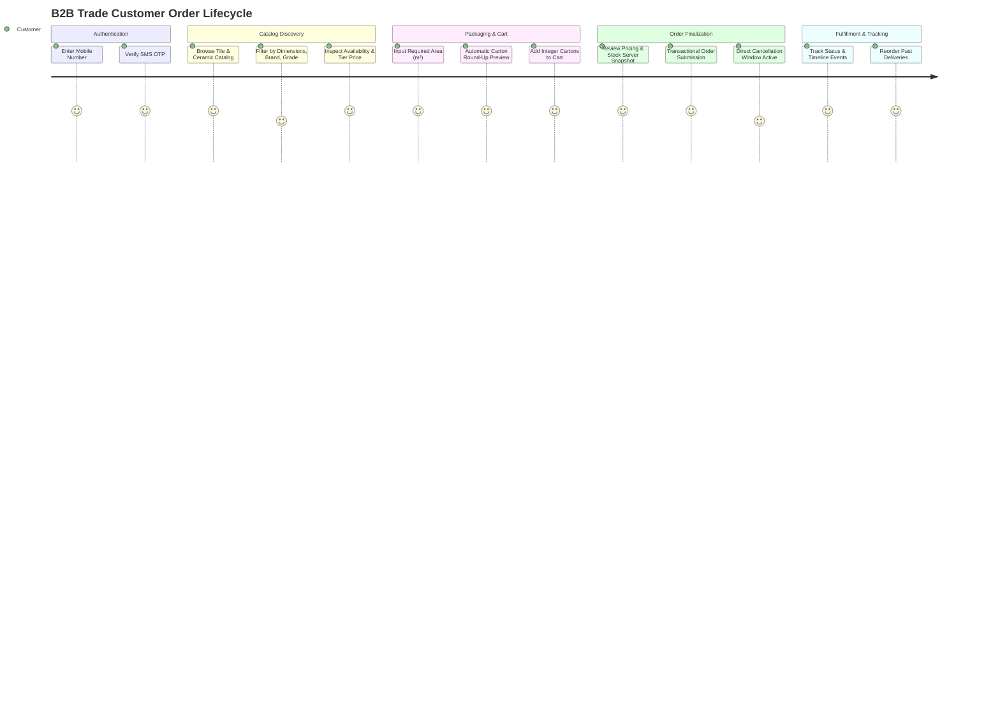

# 00 — Project Overview & Vision

## 1. Product Definition & Purpose

**PersianPart 2.0** is a private, specialized **B2B digital ordering and inventory synchronization platform** built exclusively for wholesale trade in **tiles, ceramics, porcelain slabs, and architectural cladding materials**.

It is designed for wholesale distributors selling to retail tile shops, contractors, architects, and building developers. It is **not** a public B2C e-commerce marketplace.

### The Core Problem Solved
In wholesale tile and ceramic commerce:
1. Prices vary dynamically by customer account type and credit relationship.
2. Products are priced and requested in square meters ($m^2$), but physically packaged and shipped in unbreakable whole cartons.
3. Wholesalers maintain fast-moving physical warehouse inventories synced via legacy ERP exports or manual CSV updates.
4. Ordering mistakes in unit conversion cause fulfillment shortages, billing disputes, and delivery failures.

PersianPart solves this with an exact, automated, server-authoritative conversion engine:
$$\text{Customer Request in } m^2 \longrightarrow \text{Exact Integer Carton Packaging} \longrightarrow \text{Actual Deliverable } m^2 \text{ Billing}$$

---

## 2. Actors & System Roles

The system serves three distinct roles with strictly isolated privileges:

1. **Trade Customer (`Customer`)**:
   - An authenticated commercial buyer (retail shop owner or contractor).
   - Authenticates exclusively via SMS One-Time Password (OTP).
   - Browses an authenticated, private catalog with customer-specific tier pricing.
   - Places orders by entering required area in $m^2$.
   - Tracks order fulfillment timeline and can cancel orders within an approved time window.
   - Views promotional credit terms and installment financing plans (`Plans`).

2. **Operations & Support Staff (`Support`)**:
   - Internal team member responsible for day-to-day operations.
   - Creates and manages Customer business accounts.
   - Enriches catalog metadata (dimensions, photos, technical specs, tags).
   - Reviews and updates customer order statuses through fulfillment.
   - Executes routine CSV inventory/price batch synchronizations.

3. **System Supervisor (`Admin`)**:
   - Full governance and supervisory authority.
   - Manages staff accounts, security policies, and access rights.
   - Configures Customer Types (`CustomerType`) and markup percentage rules.
   - Adjusts global commerce parameters (rounding rules, cancellation deadlines, system probes).
   - Reviews comprehensive audit event logs.

---

## 3. High-Level Customer Journey

---

## 4. Scope Specification

### 4.1 In Scope (Core Capabilities)
- **Private Authenticated Catalog**: Completely hidden from unauthenticated public traffic.
- **SMS OTP Authentication**: Passwordless, secure phone-based verification for trade customers.
- **Tile & Ceramic Domain Master Data**: Structured dimensional specs ($W \times H$), grade classification (درجه ۱ تا ۴), surface finishes, colors, and carton area multipliers (`sqmPerCarton`).
- **Tier-Based Customer Pricing**: Configurable percentage markups per `CustomerType` applied on top of the wholesale base price.
- **Precision Packaging Engine**: Mandatory server-side upward rounding from requested $m^2$ to integer cartons.
- **Atomic Order Submission & Reservation**: Prevents overselling by locking inventory at submission in a single ACID transaction.
- **Order Lifecycle & Timeline**: Deterministic state machine tracking order progression with timestamped events.
- **Customer Cancellation Grace Window**: Time-bounded self-service order cancellation that automatically releases reserved stock.
- **Reorder Workflow**: Instant creation of a fresh cart from a historical order with real-time price and stock recalculation.
- **Promotional Credit & Financing Plans**: Structured informational display of credit arrangements and installment guidelines.
- **CSV Operational Sync Pipeline**: Structured batch upload to update base price and stock without altering catalog content.
- **Suspicious-Change Detection**: Automatic warning system flagging abnormal price spikes or mass inventory drops during import.
- **Audit Logging**: Immutable tracking of critical staff actions (pricing edits, CSV imports, order status changes).

### 4.2 Explicitly Out of Scope
- Public storefront or guest checkout without an approved trade account.
- Online payment gateway integration (B2B settlements occur through trade credit, banking drafts, or invoicing).
- External shipping carrier APIs (delivery methods are handled offline by logistics dispatch).
- Complex multi-warehouse / multi-branch stock reservation.
- Product variant hierarchies (each physical SKU is an independent product record).
- Automated CSV rollback (imports require preview and human confirmation before apply).

---

## 5. Architectural Invariants & Product Principles

1. **B2B-First & Mobile-First**:
   Designed for warehouse managers, retail owners, and on-site contractors ordering on mobile devices with high speed, high information density, and zero unnecessary decorative friction.

2. **Server-Side Authoritative Rules**:
   Client calculations (e.g., carton conversions, price totals) are strictly informational previews. The server independently recalculates all carton metrics, customer prices, and inventory constraints at the moment of order submission.

3. **Separation of Content and Operations**:
   Catalog enrichment (descriptions, images, technical specifications, dimensional attributes) is managed exclusively by human staff in the administration portal. CSV batch imports are strictly restricted to updating `basePricePerSqm` and `inventorySqm`.

4. **Claim-Matched Verification & Immutability**:
   Once an order is submitted, the `OrderItem` records an immutable snapshot of all pricing, markup percentages, carton counts, and dimensional factors. Changes to current product prices or customer markups never retroactively alter historical orders.
