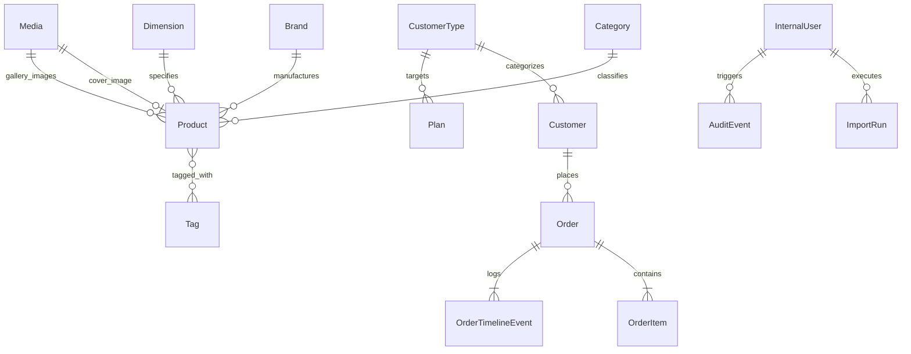

# 01 — Domain Models & Entity Specifications

This document defines the formal domain entities, their attributes, validation boundaries, and relational dependencies within the PersianPart 2.0 system.

---

## 1. Entity-Relationship Overview

---

## 2. Core Domain Entities

### 2.1 Customer Account (`Customer` / `User`)
Represents an individual trade business account (e.g., retail store, wholesale agency, or commercial contractor).

| Field Name | Type | Constraint | Description |
| :--- | :--- | :--- | :--- |
| `id` | UUID / String | Unique, Primary Key | Internal system identifier. |
| `mobile` | String | Unique, E.164 / Iran format | Primary phone number used for SMS OTP authentication. |
| `storeName` | String | Required | Commercial name of the retail store or contractor enterprise. |
| `contactName` | String | Required | Full name of the primary business contact or purchasing manager. |
| `phone` | String | Optional | Landline telephone number. |
| `province` | String | Required | Province of commercial operation. |
| `city` | String | Required | City of commercial operation. |
| `address` | Text | Required | Primary delivery/billing address. |
| `customerType` | Relation $\rightarrow$ `CustomerType` | Required | Assigned pricing tier and discount/markup policy. |
| `isActive` | Boolean | Default: `true` | When `false`, user is blocked from authenticating or ordering. |
| `internalNotes` | Text | Optional | Staff-only commercial notes (credit limits, payment terms). |
| `createdAt` | ISO-8601 Timestamp | Auto | Record creation timestamp. |
| `updatedAt` | ISO-8601 Timestamp | Auto | Last record modification timestamp. |

---

### 2.2 Customer Tier (`CustomerType`)
Defines the commercial classification of trade buyers and governs the percentage markup applied to the wholesale base price.

| Field Name | Type | Constraint | Description |
| :--- | :--- | :--- | :--- |
| `id` | UUID / String | Unique, Primary Key | Internal identifier. |
| `name` | String | Unique, Required | Commercial label (e.g., "نمایندگی انحصاری", "فروشگاه همکار", "پروژه‌ای"). |
| `slug` | String | Unique, Required | URL and code safe identifier (`exclusive-agent`, `wholesale-partner`). |
| `markupPercent` | Decimal / Number | Required | Percentage added to `basePricePerSqm` (can be `0` for zero-markup). |
| `isActive` | Boolean | Default: `true` | Whether this tier is currently selectable for customers. |
| `description` | String | Optional | Internal operational criteria for qualifying accounts. |

---

### 2.3 Product (`Product`)
Represents an independent tile, porcelain, or ceramic stock-keeping unit (SKU). Each physical variant is modelled as an independent product.

| Field Name | Type | Constraint | Description |
| :--- | :--- | :--- | :--- |
| `id` | UUID / String | Unique, Primary Key | Internal system identifier. |
| `sku` | String | Unique, Required, Immutable | Unique physical inventory SKU (e.g., `PP-CER-60120-001`). |
| `name` | String | Required | Official product title (e.g., "پرسلان بوک‌مچ کلاکاتا مات"). |
| `slug` | String | Unique, Required | Clean slug for web routing and identification. |
| `category` | Relation $\rightarrow$ `Category` | Required | Architectural categorization. |
| `brand` | Relation $\rightarrow$ `Brand` | Optional | Tile manufacturer or factory brand. |
| `dimension` | Relation $\rightarrow$ `Dimension` | Required | Standardized dimensional record. |
| `width` | Number (cm / mm) | Derived / Stored | Physical width of the tile. |
| `height` | Number (cm / mm) | Derived / Stored | Physical length/height of the tile. |
| `sqmPerCarton` | Number (Float) | Required, $> 0$ | **Authoritative packaging factor**: square meters in one full carton. |
| `piecesPerCarton`| Integer | Required, $\ge 1$ | Number of individual tile slabs in each carton. |
| `color` | String | Optional | Predominant color tone (سفید، طوسی تیره، کرم، زغالی). |
| `grade` | Enum / String | Required | Quality grading: `grade_1` (درجه ۱), `grade_2`, `grade_3`, `grade_4`. |
| `finish` | String | Optional | Surface texture: مات (Matte), براق (Glossy), شوگرلپ (Sugar Lap). |
| `tags` | Relation $\rightarrow$ `Tag[]` | Many-to-Many | Descriptive attributes (ضد اسید، کالیبره، رکتیفای، ضد لغزش). |
| `cover` | Relation $\rightarrow$ `Media` | Optional | Primary high-resolution catalog photo. |
| `gallery` | Array of `Media` | Optional | Additional photos, edge details, and ambient interior shots. |
| `richDescription` | RichText / Markdown | Optional | Detailed technical properties, water absorption rate, PEI rating. |
| `basePricePerSqm` | Integer (Tomans) | Required, $\ge 0$ | Wholesale baseline cost per $m^2$ (owned by CSV). |
| `inventorySqm` | Number (Float) | Required, $\ge 0$ | Total available inventory in $m^2$ (owned by CSV & Order deductions). |
| `stockCartons` | Integer | Derived | Calculated integer carton stock: $\lfloor \text{inventorySqm} / \text{sqmPerCarton} \rfloor$. |
| `isActive` | Boolean | Default: `true` | Visibility flag for the customer catalog. |

---

### 2.4 Supporting Catalog Taxonomies

#### Category (`Category`)
- `name`: Category title (e.g., "پرسلان کف", "اسلب پرسلان", "دیوار لوکس", "نما و محوطه").
- `slug`: URL identifier.
- `ordering`: Integer weight for catalog menu display order.
- `isActive`: Boolean status flag.

#### Brand (`Brand`)
- `name`: Manufacturer name (e.g., "کاشی پرسپولیس", "کاشی تکسرام", "کاشی مهسرام").
- `slug`: Identifier.
- `logo`: Optional media reference.
- `isActive`: Boolean status flag.

#### Dimension (`Dimension`)
- `name` / `label`: Display label (e.g., `60x120`, `120x120`, `120x240`).
- `width`: Integer width in centimeters.
- `height`: Integer height in centimeters.

#### Tag (`Tag`)
- `name`: Attribute name (e.g., "کالیبره / بدون بند", "مقاوم در برابر انجماد", "نانو پولیش").
- `slug`: Tag identifier.

---

### 2.5 Promotional Financing & Credit Terms (`Plan`)
Provides clear, structured, informational cards displayed to qualified trade customers regarding credit lines, payment milestones, and installment terms.

| Field Name | Type | Constraint | Description |
| :--- | :--- | :--- | :--- |
| `id` | UUID / String | Unique, Primary Key | Plan identifier. |
| `title` | String | Required | Headline (e.g., "طرح خرید اقساطی ۳ ماهه همکاران"). |
| `targetCustomerTypes` | Relation $\rightarrow$ `CustomerType[]` | Optional | Restricts display to specific tiers (or public to all). |
| `prepaymentPercent` | Number (Percentage) | Optional | Recommended down-payment percentage (e.g., $30\%$). |
| `tenorMonths` | Integer | Optional | Duration of installment term in months (e.g., 3, 6). |
| `interestPercent` | Number | Optional | Financing rate (or $0\%$ for promotional terms). |
| `description` | Text | Required | Informational conditions, required bank checks, and clearance terms. |
| `isActive` | Boolean | Default: `true` | Display status. |

---

### 2.6 Order & Transaction Snapshot (`Order` & `OrderItem`)

#### Order (`Order`)
Represents the commercial transaction submitted by a Customer.

| Field Name | Type | Description |
| :--- | :--- | :--- |
| `id` | UUID / String | Unique order tracking ID. |
| `orderNumber` | String | Sequential human-readable reference (e.g., `ORD-2026-1049`). |
| `customer` | Relation $\rightarrow$ `Customer` | Purchasing trade account. |
| `status` | Enum | Deterministic order state (see Section 3 in Business Rules). |
| `subtotal` | Integer (Tomans) | Sum of all `lineTotal` calculations. |
| `discountAmount` | Integer (Tomans) | Manual or plan-based order discount. |
| `taxAmount` | Integer (Tomans) | VAT or sales tax (if configured). |
| `finalTotal` | Integer (Tomans) | Net payable order amount: $\text{subtotal} - \text{discount} + \text{tax}$. |
| `deliveryAddress` | Text | Delivery destination address confirmed during submission. |
| `notes` | Text | Customer remarks regarding delivery site, unloading restrictions. |
| `cancellationDeadline` | ISO Timestamp | Expiration timestamp for self-service customer cancellation. |
| `cancelledBy` | Enum | `customer` or `admin` (when status is `cancelled`). |
| `createdAt` | ISO Timestamp | Order submission timestamp. |

#### OrderItem (`OrderItem`) — Immutable Transaction Snapshot
**Critical Invariant**: Once created, `OrderItem` never references live product pricing or live customer markup. It captures the exact mathematical values at the second of checkout:

| Snapshot Field | Type | Description |
| :--- | :--- | :--- |
| `productId` | String | Original ID of the Product. |
| `sku` | String | Product SKU at checkout time. |
| `productName` | String | Product title at checkout time. |
| `requestedSqm` | Number (Float) | Area initially entered by customer. |
| `cartonCount` | Integer | Integer cartons calculated and billed: $\lceil \text{requestedSqm} / \text{sqmPerCarton} \rceil$. |
| `sqmPerCarton` | Number (Float) | Packaging factor applied for conversion. |
| `actualSqm` | Number (Float) | Actual physical area delivered: $\text{cartonCount} \times \text{sqmPerCarton}$. |
| `basePricePerSqm` | Integer (Tomans) | Active wholesale base price per $m^2$. |
| `customerTypeId` | String | ID of customer's tier at checkout. |
| `customerTypeName` | String | Name of customer's tier at checkout. |
| `markupPercent` | Number | Applied markup percentage. |
| `finalPricePerSqm` | Integer (Tomans) | Final computed unit price per $m^2$ (after rounding). |
| `lineTotal` | Integer (Tomans) | Total line item cost: $\text{actualSqm} \times \text{finalPricePerSqm}$. |

---

### 2.7 Order Timeline Event (`OrderTimelineEvent`)
An append-only audit trail logging every step in the lifecycle of an order:

| Field Name | Type | Description |
| :--- | :--- | :--- |
| `id` | String | Event ID. |
| `orderId` | Relation $\rightarrow$ `Order` | Associated order. |
| `eventType` | Enum | `order_created`, `status_changed`, `customer_cancelled`, `staff_cancelled`, `order_completed`. |
| `actorType` | Enum | `customer`, `support`, `admin`, or `system`. |
| `actorId` | String | User ID who initiated the event. |
| `title` | String | Human-readable title (e.g., "تأیید سفارش توسط بازرگانی"). |
| `description` | String | Contextual details or cancellation reasons. |
| `timestamp` | ISO Timestamp | Exact execution time. |

---

### 2.8 CSV Batch Import Audit (`ImportRun`)
Captures every CSV pricing and inventory batch operation executed by staff:

- `filename`: Original uploaded CSV filename.
- `actorId`: Staff member executing the operation.
- `status`: `pending_preview`, `applied`, `rejected`.
- `totalRows`: Total rows in CSV.
- `validRows`: Successfully matched rows.
- `changedRows`: Count of rows with price/inventory modifications.
- `unchangedRows`: Count of identical rows.
- `unknownSkuRows`: Rows referencing non-existent SKUs (skipped).
- `invalidRows`: Malformed, negative, or unparsable numeric rows.
- `suspiciousChanges`: Summary report of flagged anomalies (e.g., price swings $> 30\%$).
- `appliedAt`: Exact timestamp when database update was committed.
