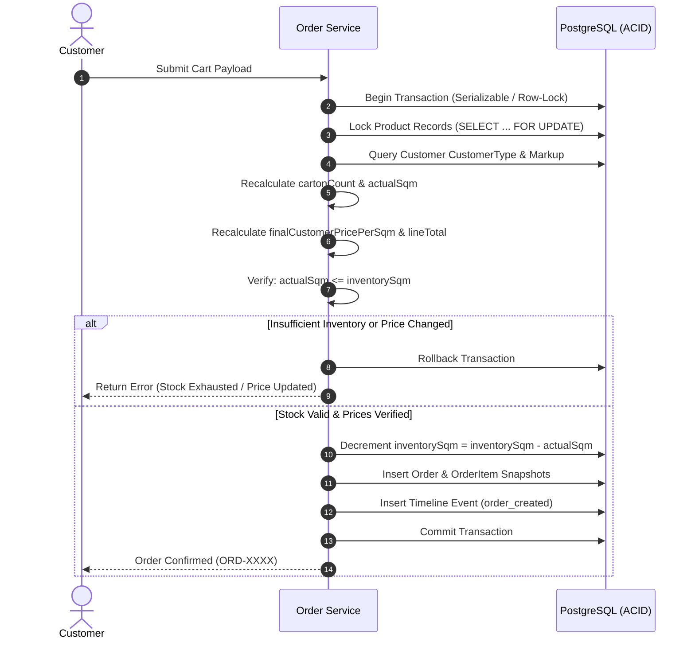

# 02 — Business Rules & Computational Invariants

This document serves as the authoritative specification for all financial, packaging, inventory, and lifecycle logic in PersianPart 2.0.

---

## 1. Canonical Units & Standard Measures

To eliminate ambiguity across all modules, the system enforces five canonical measurement units:

| Dimension | Canonical Unit | Unit Symbol / Notes |
| :--- | :--- | :--- |
| **Currency** | Iranian Toman | تومان (Persian Toman) |
| **Price Unit** | Toman per square meter | تومان / $m^2$ |
| **Inventory Unit** | Square meter | $m^2$ (متر مربع) |
| **Customer Input** | Square meter | $m^2$ (floating-point decimal input) |
| **Physical Packaging** | Carton | عدد کارتن (strictly positive integer) |

---

## 2. Customer Tier Pricing Engine

### 2.1 The Markup Formula
Every authenticated Customer is assigned exactly one `CustomerType`. Each tier specifies a non-negative decimal `markupPercent`:

$$\text{rawCustomerPrice} = \text{basePricePerSqm} \times \left( 1 + \frac{\text{markupPercent}}{100} \right)$$

$$\text{finalCustomerPricePerSqm} = \text{applyRoundingPolicy}(\text{rawCustomerPrice})$$

### 2.2 Rounding Policy
Unless overridden by Global configuration, prices in Iranian Tomans are rounded to the nearest thousand (1,000 Tomans) or standard integer unit to avoid unmanageable fractional denominations:

$$\text{applyRoundingPolicy}(P) = \text{round}(P)$$

### 2.3 Pricing Invariants
1. **Confidentiality Gate**: The customer client application MUST NEVER receive `basePricePerSqm` or `markupPercent`. It only receives `finalCustomerPricePerSqm`.
2. **Server-Side Recalculation**: Pricing is never trusted from the client request payload. At checkout, the server re-queries the customer's current `CustomerType` and the product's current `basePricePerSqm`.
3. **Historical Immutability**: Changes to a customer's tier or a product's base price NEVER retroactively modify historical orders or existing `OrderItem` snapshots.

---

## 3. Packaging & Carton Conversion Mathematics

Tile and ceramic products cannot be broken into individual slabs or fractions during warehouse picking. All warehouse dispatches occur in complete cartons.

### 3.1 Conversion Formulas

Given:
- $\text{requestedSqm}$: Desired area entered by the customer ($m^2$).
- $\text{sqmPerCarton}$: Official square meters packed per carton (from product master record).
- $\text{finalCustomerPricePerSqm}$: Validated unit price per $m^2$.

The conversion engine executes:

$$\text{cartonCount} = \left\lceil \frac{\text{requestedSqm}}{\text{sqmPerCarton}} \right\rceil$$

$$\text{actualSqm} = \text{cartonCount} \times \text{sqmPerCarton}$$

$$\text{lineTotal} = \text{actualSqm} \times \text{finalCustomerPricePerSqm}$$

### 3.2 Packaging Invariants
1. **Mandatory Ceil (Round-Up)**: Downward rounding ($\lfloor \dots \rfloor$) or standard half-rounding is strictly forbidden. Any fractional carton requirement always rounds up to the next full carton.
2. **Billed on Deliverable Area**: The customer is charged for $\text{actualSqm}$, NOT $\text{requestedSqm}$.
3. **Carton Integer Constraint**: $\text{cartonCount}$ must always be a positive integer ($\text{cartonCount} \in \mathbb{Z}^+$).
4. **Source of Truth for Multiplier**: $\text{sqmPerCarton}$ is the single source of truth. Theoretical areas calculated from dimensions ($\text{width} \times \text{height} \times \text{pieces}$) are used for data validation only and must never override `sqmPerCarton`.

---

## 4. Inventory Validation & Availability Status

### 4.1 Stock Constraint
An order item is orderable if and only if the physical warehouse inventory can satisfy the entire deliverable quantity:

$$\text{actualSqm} \le \text{inventorySqm}$$

- **No Backorders**: If $\text{actualSqm} > \text{inventorySqm}$, the line item MUST be rejected with `INSUFFICIENT_STOCK`. Partial carton dispatches or negative inventory balances are prohibited.

### 4.2 Availability Badge Classification
To provide rapid visual scanning in mobile views, the system derives an availability badge:

$$\text{AvailabilityBadge} = \begin{cases}
\text{in\_stock} & \text{if } \text{inventorySqm} \ge \text{threshold}_{\text{high}} \\
\text{low\_stock} & \text{if } 0 < \text{inventorySqm} < \text{threshold}_{\text{high}} \\
\text{out\_of\_stock} & \text{if } \text{inventorySqm} \le 0
\end{cases}$$

*(Default $\text{threshold}_{\text{high}}$ is typically 50 cartons or equivalent $m^2$, configurable globally).*

---

## 5. Order Submission & Transactional Isolation

### 5.1 The Atomic Checkout Gate
When an authenticated Customer submits a cart:

### 5.2 Stock Reservation Rule
- The submission transaction atomically decrements `inventorySqm`.
- In PersianPart 2.0, `inventorySqm` represents the **currently available-to-order** stock.

---

## 6. Order Cancellation & Stock Restoration

### 6.1 Customer Cancellation Window
Orders are created with an automated grace window for direct customer cancellation:

$$\text{cancellationDeadline} = \text{createdAt} + \text{customerCancellationWindowMinutes}$$

*(Default configuration: 30 minutes, adjustable in Global settings).*

### 6.2 Cancellation Rules
1. **Self-Service Customer Cancellation**:
   - Allowed only when $\text{now}() \le \text{cancellationDeadline}$ AND status is `pending_review`.
   - Once cancelled, the system executes an atomic transaction:
     - Sets order status to `cancelled`.
     - Sets `cancelledBy = 'customer'`.
     - Restores reserved stock: $\text{inventorySqm} = \text{inventorySqm} + \text{actualSqm}$ for every item in the order.
     - Appends an audit timeline event (`customer_cancelled`).
2. **Post-Deadline Cancellation**:
   - If $\text{now}() > \text{cancellationDeadline}$, direct cancellation in the customer application is disabled.
   - The customer must contact Support. Only internal staff (`Support` or `Admin`) can initiate a cancellation.
3. **Idempotent Restoration**:
   - Stock restoration must execute **exactly once**. Subsequent status modifications on an already cancelled order cannot re-increment inventory.

---

## 7. Reorder Logic

The Reorder capability allows a trade customer to quickly re-purchase items from a past delivery without manual search:

1. **No Auto-Submit**: Reorder NEVER clones an order or executes immediate checkout.
2. **Fresh Cart Initialization**: The system extracts the product IDs and requested $m^2$ from the historical `OrderItem` snapshots into a new live shopping cart.
3. **Current Truth Evaluation**:
   - Fetches live product availability and active pricing.
   - Re-runs packaging conversion with current packaging factors.
   - If an item is out of stock or discontinued, it is flagged as unavailable in the cart.
   - If prices have changed, the new price is displayed with a notification.
4. **Standard Submission Required**: The customer must review and confirm the newly generated cart through the normal transactional checkout pipeline.

---

## 8. CSV Authority & Sync Boundaries

CSV batch imports represent the automated bridge to external inventory management.

### 8.1 The Strict Operational Ownership Boundary
| Property | CSV Owned? | Admin / CMS Owned? |
| :--- | :---: | :---: |
| `basePricePerSqm` | **YES** | Read-Only in typical workflow |
| `inventorySqm` | **YES** | Auto-decremented by orders |
| Product Name, Slug, Description | NO | **YES** (Authoritative) |
| Category, Brand, Tags | NO | **YES** (Authoritative) |
| Dimensions ($W \times H$) | NO | **YES** (Authoritative) |
| Packaging ($\text{sqmPerCarton}$, pieces) | NO | **YES** (Authoritative) |
| Media, Covers, Gallery | NO | **YES** (Authoritative) |

### 8.2 SKU Handling Rules
- **Known SKU**: Matches existing database record; calculates proposed diff in price and stock.
- **Unknown SKU**: SKU present in CSV but absent in database $\rightarrow$ Row is skipped, logged as an unknown item, and does not halt the remaining valid rows.
- **Absent SKU**: Product exists in database but is missing from CSV $\rightarrow$ Untouched (retains existing price and stock).
- **Duplicate SKU in CSV**: Hard validation error; the entire import file is rejected to prevent race conditions or undefined overrides.
