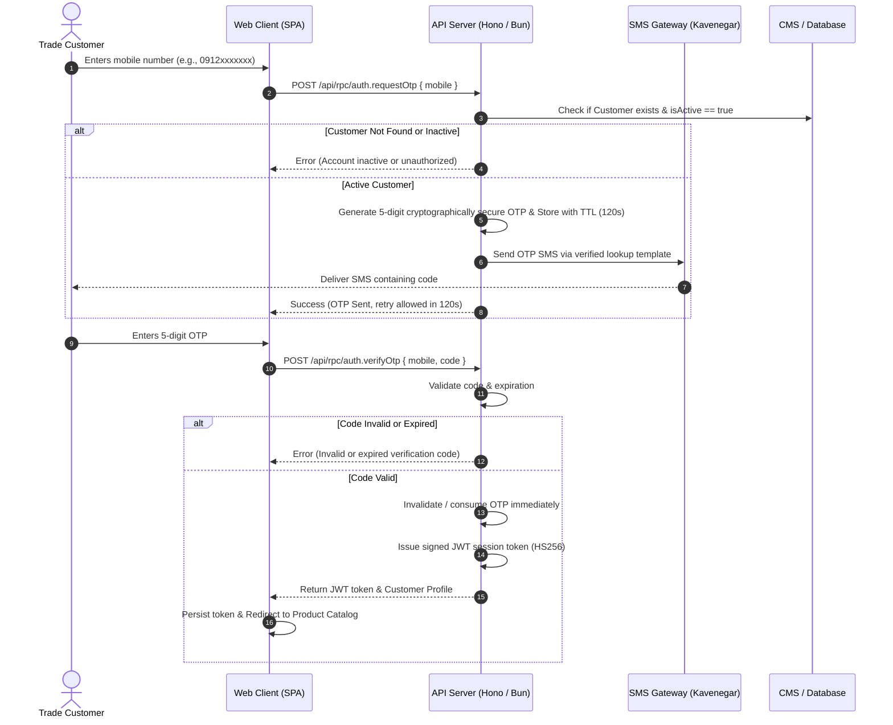
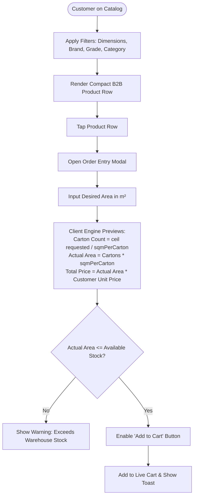
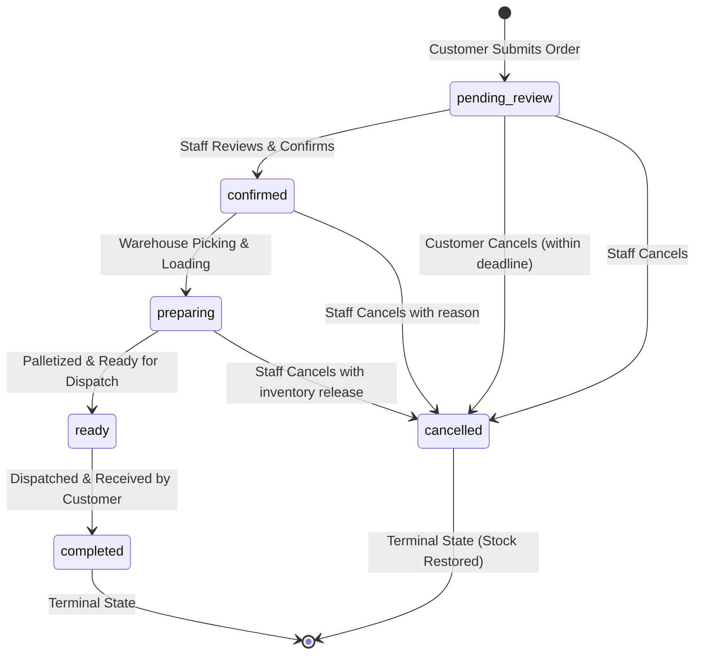
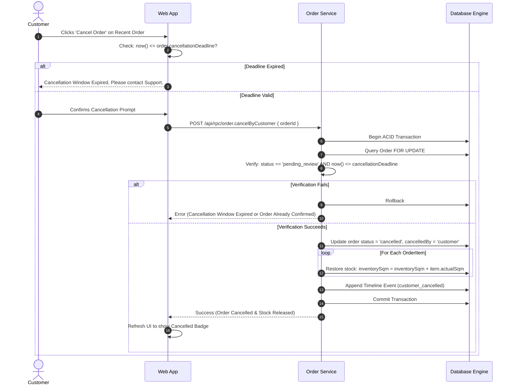
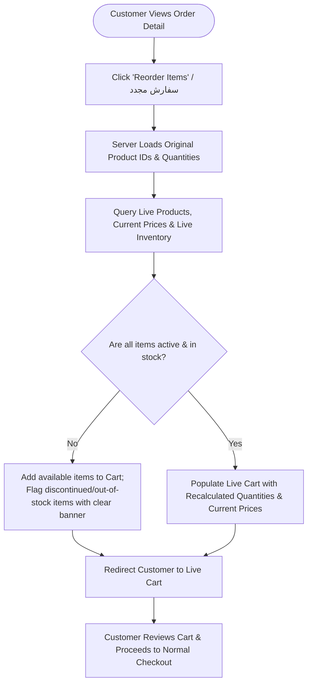
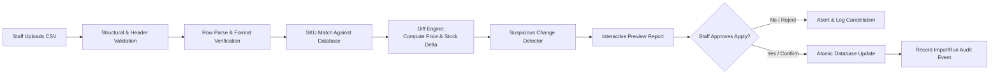

# 03 — Core System Flows & Lifecycle State Machines

This document specifies the end-to-end procedural workflows and deterministic state transitions governing PersianPart 2.0.

---

## 1. Authentication & Session Flow (SMS OTP)

PersianPart 2.0 enforces a passwordless, phone-based authentication model for trade customers.

### Authentication Rules
- **Rate Limiting**: An individual phone number cannot request more than 1 OTP per 2 minutes, and is blocked for 15 minutes after 5 consecutive incorrect verify attempts.
- **Single-Use Consumption**: Once verified, the OTP is instantly purged from active memory/cache to prevent replay attacks.
- **Never Log Secrets**: The cleartext OTP value is NEVER logged to technical logs or audit trails.

---

## 2. Product Discovery & Order Entry Flow

---

## 3. Order Lifecycle State Machine

The order lifecycle is governed by a deterministic, finite state machine with strict transition guards:

### 3.1 Allowed Statuses & State Definitions

| Status Key | Persian Display Label | Definition & Operational Meaning |
| :--- | :--- | :--- |
| `pending_review` | در حال بررسی واحد بازرگانی | Newly submitted order awaiting commercial verification. Eligible for customer self-cancellation. |
| `confirmed` | تأیید شده توسط بازرگانی | Commercial team has verified inventory, pricing, and account standing. |
| `preparing` | در حال بارگیری و انبارداری | Physical cartons are being picked, palletized, and prepared at the central warehouse. |
| `ready` | آماده تحویل / بارگیری | Goods are loaded on truck or ready for transport pickup. |
| `completed` | تکمیل و تحویل شده | Delivery confirmed and goods accepted by the trade customer. Terminal state. |
| `cancelled` | لغو شده | Order voided; reserved inventory restored to warehouse. Terminal state. |

### 3.2 Transition Invariants
1. **Unidirectional Flow**: Statuses move forward strictly along the primary track. Backward transitions (e.g., `preparing` $\rightarrow$ `pending_review`) are prohibited.
2. **Terminal Inviolability**: `completed` and `cancelled` are permanent terminal states. No further status changes can occur on a completed or cancelled order.
3. **No Free-Form Edits**: Statuses cannot be edited arbitrarily; every transition must occur via authorized command endpoints that trigger stock checks and audit events.

---

## 4. Customer Self-Service Cancellation Flow

---

## 5. Reorder Workflow

**Key Principle**: Reorder is an accelerator for purchasing, **never an automatic re-submission**. The customer must always review and execute standard checkout.

---

## 6. CSV Operational Sync Pipeline

### Pipeline Phases
1. **Upload & Parse**: Reads CSV data; validates UTF-8 encoding and required columns (`sku`, `basePricePerSqm`, `inventorySqm`).
2. **Row Validation**: Verifies that prices and stock values are valid non-negative numbers. Invalid or duplicate SKUs inside the CSV halt the file.
3. **SKU Matching**:
   - Matched SKUs are queued for diff computation.
   - Unmatched SKUs (in CSV but not in DB) are reported in the preview report and skipped during update.
4. **Suspicious-Change Detection**:
   - Flags any single product experiencing a base price swing exceeding $30\%$.
   - Flags any batch where more than $20\%$ of catalog SKUs suddenly drop to zero inventory.
   - Displays prominent visual warnings on the preview screen before allowing staff to click "Apply".
5. **Apply**: Commits the operational delta in a single transaction, updating `basePricePerSqm` and `inventorySqm` across all matched products.
