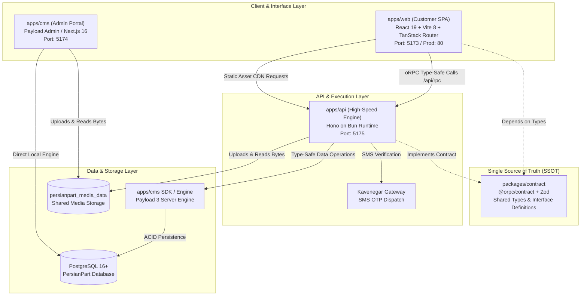

# 05 — Architecture, Contracts & Technical Topology

This document specifies the technical architecture, data contract specifications (SSOT), communication topologies, and deployment infrastructure of PersianPart 2.0.

---

## 1. Clean Monorepo Architecture

PersianPart 2.0 is structured as a **Contract-First Monorepo** managed via `pnpm workspaces`.

```
persianpart/
├── packages/
│   └── contract/       # Single Source of Truth (SSOT) Data Contracts & Zod Schemas
└── apps/
    ├── cms/            # Content & Data Layer (Payload CMS 3 + PostgreSQL)
    ├── api/            # High-Performance API & Business Engine (Hono + Bun)
    └── web/            # B2B Trade Customer SPA (React 19 + TanStack Router + Tailwind v4)
```

### 1.1 Structural Topology & Data Flow



---

## 2. Contract-First API Specification (`@persianpart/contract`)

All data boundaries are declared in `packages/contract` using **Zod** and **oRPC v2**. Neither the frontend nor the backend may establish custom endpoints or models without a prior formal declaration in this contract package.

### 2.1 The Root Application Contract (`appContract`)

```typescript
export const appContract = {
  // 1. Health & Heartbeat
  health: oc.output(HealthCheckOutputSchema),

  // 2. Customer & Staff Authentication
  auth: {
    requestOtp: oc.input(RequestOtpInputSchema).output(RequestOtpOutputSchema),
    verifyOtp: oc.input(VerifyOtpInputSchema).output(VerifyOtpOutputSchema),
    me: oc.output(AuthSessionSchema),
    logout: oc.output(StandardSuccessSchema),
  },

  // 3. Tile & Ceramic Catalog
  catalog: {
    list: oc.input(CatalogQuerySchema).output(PaginatedProductsSchema),
    getBySlug: oc.input(SlugParamSchema).output(ProductDetailSchema),
    getById: oc.input(EntityIdParamSchema).output(ProductDetailSchema),
    categories: oc.output(CategoryListSchema),
    brands: oc.output(BrandListSchema),
    tags: oc.output(TagListSchema),
    dimensions: oc.output(DimensionListSchema),
    calculateCartons: oc.input(CartonCalculationInputSchema).output(CartonCalculationOutputSchema),
  },

  // 4. Customer Profile
  customer: {
    getProfile: oc.output(CustomerProfileSchema),
    updateProfile: oc.input(UpdateCustomerProfileSchema).output(CustomerProfileSchema),
  },

  // 5. Order Management & Checkout
  order: {
    validateCart: oc.input(CartValidationInputSchema).output(CartValidationOutputSchema),
    submit: oc.input(SubmitOrderInputSchema).output(OrderConfirmationSchema),
    list: oc.input(OrderFilterSchema).output(PaginatedOrdersSchema),
    getById: oc.input(EntityIdParamSchema).output(OrderDetailSchema),
    cancelByCustomer: oc.input(CancelOrderInputSchema).output(StandardSuccessSchema),
    prepareReorder: oc.input(EntityIdParamSchema).output(ReorderPreparationSchema),
  },

  // 6. Credit & Promotional Financing Plans
  plan: {
    list: oc.output(PlanListSchema),
  },

  // 7. System Administration & Operations
  system: {
    getAuditLogs: oc.input(AuditLogFilterSchema).output(PaginatedAuditLogsSchema),
    previewCsvImport: oc.input(CsvUploadPayloadSchema).output(CsvDiffPreviewSchema),
    applyCsvImport: oc.input(CsvApplyPayloadSchema).output(CsvApplySummarySchema),
    getGlobalConfig: oc.output(GlobalConfigSchema),
    updateGlobalConfig: oc.input(UpdateGlobalConfigSchema).output(GlobalConfigSchema),
  },
}
```

---

## 3. Standard Error Envelope

All procedures uniformly return errors conforming to the standardized oRPC error format:

```json
{
  "code": "INSUFFICIENT_STOCK",
  "status": 400,
  "message": "موجودی انبار برای متراژ درخواستی (۷۲ متر مربع) کافی نیست. حداکثر موجودی: ۵۱.۸۴ متر مربع",
  "data": {
    "sku": "PP-CER-60120-001",
    "requestedSqm": 72.0,
    "availableSqm": 51.84,
    "sqmPerCarton": 1.44
  }
}
```

### Standard Error Codes
| Code | HTTP Status | Definition |
| :--- | :---: | :--- |
| `BAD_REQUEST` | 400 | Malformed input, negative values, or schema violations. |
| `UNAUTHORIZED` | 401 | Missing, invalid, or expired JWT bearer token. |
| `FORBIDDEN` | 403 | Attempting to access resources owned by another customer. |
| `NOT_FOUND` | 404 | Entity (Product, Order, Customer) does not exist. |
| `CONFLICT` | 409 | Concurrent order collision, duplicate SKU, or state transition violation. |
| `INTERNAL_SERVER_ERROR`| 500 | Unhandled database or operational exception. |

---

## 4. Media Storage & Delivery Topology

Tile and ceramic catalogs are visually heavy, requiring high-resolution photos of tile textures, edge bevels, and ambient staging.

```
       Upload File (Multipart/Form-Data)
                   │
                   ▼
┌─────────────────────────────────────────────────────┐
│  API Gateway / CMS Upload Endpoint                  │
│  - Sanitize filename (ASCII + Persian Unicode)      │
│  - Validate MIME types: JPG, PNG, WEBP, AVIF, SVG   │
│  - Enforce size limits (max 15MB)                   │
└──────────────────┬──────────────────────────────────┘
                   │ Write to disk
                   ▼
┌─────────────────────────────────────────────────────┐
│  Shared Storage Volume (`persianpart_media_data`)   │
│  Canonical path: `/app/media`                       │
└──────────────────┬──────────────────────────────────┘
                   │ Read access
                   ▼
┌─────────────────────────────────────────────────────┐
│  Static File Delivery Service (Nginx / API Fallback)│
│  - Route: `/api/media/file/:filename`               │
│  - Header: Cache-Control: public, max-age=31536000  │
│  - Direct Zero-Copy Streaming (Bun.file / sendfile) │
└─────────────────────────────────────────────────────┘
```

---

## 5. Deployment & Containerization Topology

PersianPart 2.0 deploys as a set of coordinated micro-services via **Docker Compose** on **Dokploy**:

| Service Name | Base Image / Runtime | Port / Exposure | Responsibility |
| :--- | :--- | :---: | :--- |
| **`migration`** | Node.js (Payload CLI) | *None* (One-shot) | Executes pending database migrations on startup. Runs before API or CMS boots. |
| **`api`** | Bun (`oven/bun:1.2`) | `5175` | Serves Hono oRPC endpoints, JWT auth, SMS OTP integration, and media streaming. |
| **`cms`** | Node.js 22 (Next.js 16) | `5174` | Serves Payload Admin UI for internal staff and manages raw data collections. |
| **`web`** | Nginx (`alpine`) | `80` | Serves compiled React 19 SPA static assets and proxies `/api/*` to `api:5175`. |
| **`postgres`** | PostgreSQL 16+ | `5432` | Relational database engine with ACID transactional support. |

### Environment Variables & Configuration Invariants
- `DATABASE_URI` / `DATABASE_URL`: Connection string to PostgreSQL instance.
- `PAYLOAD_SECRET`: 32+ character cryptographic secret for administrative sessions.
- `JWT_SECRET`: 32+ character HMAC-SHA256 secret for trade customer mobile sessions.
- `KAVENEGAR_API_KEY`: API credential for the SMS verification gateway.
- `MEDIA_DIR`: Canonical directory path for shared media persistence.
